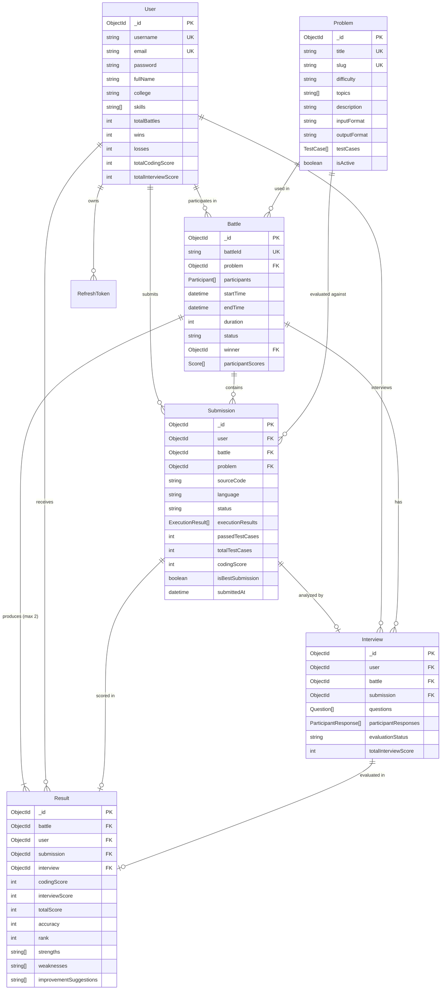

# ⚔️ Code Armada — Member 4: Database Design & Management

> **AI-Powered Coding Battle Arena — Core MongoDB Database Architecture & RESTful API Engine**
> Module Lead: Member 4 (Database Architect & Backend Engineer)

---

## 📋 Table of Contents
1. [Overview & Role Responsibilities](#-overview--role-responsibilities)
2. [Technologies Used](#-technologies-used)
3. [Architecture & Folder Structure](#-architecture--folder-structure)
4. [Database Connection & Environment Configuration](#-database-connection--environment-configuration)
5. [Database Relationships & Mermaid ER Diagram](#-database-relationships--mermaid-er-diagram)
6. [Mongoose Schemas & Data Models](#-mongoose-schemas--data-models)
7. [REST API Documentation & Contracts](#-rest-api-documentation--contracts)
8. [Leaderboard Aggregation & Performance Analytics](#-leaderboard-aggregation--performance-analytics)
9. [Integration Guide for Team Members (2, 3, 5)](#-integration-guide-for-team-members-2-3-5)
10. [Database Seeding & Verification](#-database-seeding--verification)
11. [Automated Testing Suite](#-automated-testing-suite)
12. [Postman & Thunder Client Testing](#-postman--thunder-client-testing)
13. [Troubleshooting & Common Errors](#-troubleshooting--common-errors)
14. [Step-by-Step Viva & Professor Presentation Guide](#-step-by-step-viva--professor-presentation-guide)

---

## 🎯 Overview & Role Responsibilities

In **Code Armada**, two participants battle in a 1v1 arena over a DSA problem, submit their code for automated execution, answer AI-generated technical interview questions grounded in their actual code, and receive an AI-powered performance evaluation.

As **Member 4 (Database Design & Management)**, my responsibility is to design, implement, and maintain the entire persistent data tier and data access services for the platform:
- Model and enforce data integrity across all 7 core domain entities: **Users**, **Problems**, **Battles**, **Submissions**, **Interviews**, **Results**, and **RefreshTokens**.
- Protect sensitive data: **hidden test cases must never leak** to candidates, and passwords must be salted and hashed with bcrypt.
- Implement robust MongoDB connection handling for both local instances and MongoDB Atlas clusters.
- Author aggregation pipelines to drive real-time global and college leaderboards.
- Ensure seamless integration points for **Member 2 (Authentication)**, **Member 3 (Socket.IO Multiplayer)**, and **Member 5 (AI Interview Agent)**.

---

## 🛠 Technologies Used

| Technology | Purpose |
|---|---|
| **Node.js (v20+)** | Server-side JavaScript runtime (ES Modules) |
| **Express.js (v4.x)** | RESTful API routing, controllers, and centralized middleware |
| **MongoDB (v7.x / v8.x)** | Document database for flexible, schema-validated storage |
| **Mongoose (v8.x)** | Object Data Modeling (ODM) with schema validation, hooks, and indexes |
| **bcryptjs** | Blowfish cryptographic password hashing with 10 salt rounds |
| **jsonwebtoken (JWT)** | Stateless bearer token authentication & payload verification |
| **dotenv** | Environment variable management |
| **cors** | Cross-Origin Resource Sharing configuration |
| **Node Test Runner & Supertest** | Native test execution with full HTTP assertion coverage |

---

## 🏗 Architecture & Folder Structure

```text
backend/
├── src/
│   ├── config/
│   │   └── db.js                 # MongoDB connection lifecycle, listeners & graceful exit
│   ├── models/                   # Mongoose Schemas & Data Models
│   │   ├── User.js               # User profile, bcrypt pre-save, codingStats
│   │   ├── Problem.js            # DSA problem, hidden testcase protection, slug
│   │   ├── Battle.js             # 1v1 battle state machine, 2-player validation
│   │   ├── Submission.js         # Source code, execution results, best-submission tracking
│   │   ├── Interview.js          # AI-generated questions, candidate answers & marks
│   │   ├── Result.js             # Final battle outcome, AI report, rank, duplicate check
│   │   ├── RefreshToken.js       # JWT refresh tokens with MongoDB TTL auto-cleanup
│   │   └── index.js              # Barrel export for all models
│   ├── controllers/              # Business logic & request handling
│   │   ├── userController.js
│   │   ├── problemController.js
│   │   ├── battleController.js
│   │   ├── submissionController.js
│   │   ├── interviewController.js
│   │   └── resultController.js
│   ├── routes/                   # Express route definitions
│   │   ├── userRoutes.js
│   │   ├── problemRoutes.js
│   │   ├── battleRoutes.js
│   │   ├── submissionRoutes.js
│   │   ├── interviewRoutes.js
│   │   └── resultRoutes.js
│   ├── services/                 # Complex database queries & aggregation pipelines
│   │   ├── leaderboardService.js # High-performance MongoDB Aggregation pipeline
│   │   └── statisticsService.js  # Atomic stats sync & historical performance analysis
│   ├── middleware/
│   │   ├── authMiddleware.js     # JWT extraction, verification, & optionalAuth
│   │   └── errorMiddleware.js    # CastError, ValidationError, duplicate key handler
│   ├── utils/
│   │   └── asyncHandler.js       # Async error wrapper eliminating try/catch blocks
│   ├── scripts/
│   │   ├── seed.js               # Comprehensive database population script
│   │   └── clearDemoData.js      # Clean database purge script
│   ├── app.js                    # Express app initialization & route mounting
│   └── server.js                 # Server entrypoint (starts listener ONLY after DB connects)
├── tests/
│   └── runAllTests.js            # 19 comprehensive automated tests
├── .env.example                  # Environment variable reference
├── Code_Armada_API_Collection.json # Postman / Thunder Client importable collection
├── package.json
└── README.md
```

---

## 🔌 Database Connection & Environment Configuration

The server follows a strict architectural rule: **The Express HTTP server only starts after a healthy MongoDB connection is verified.**

### Environment Setup (`.env`)
Create a `.env` file in the `backend/` directory:
```env
PORT=5000
NODE_ENV=development
# Local MongoDB:
MONGODB_URI=mongodb://127.0.0.1:27017/code_armada

# MongoDB Atlas (uncomment for cloud):
# MONGODB_URI=mongodb+srv://<username>:<password>@cluster0.xxxx.mongodb.net/code_armada?retryWrites=true&w=majority

JWT_SECRET=code_armada_super_secure_jwt_secret_key_2026
JWT_EXPIRE=7d
CORS_ORIGIN=*
```

### Starting MongoDB
- **Local MongoDB**: Ensure the MongoDB service is running:
  - Windows: `Get-Service -Name *mongo*` or `net start MongoDB`
  - Linux/Mac: `sudo systemctl start mongod` or `brew services start mongodb/brew/mongodb-community`
- **MongoDB Atlas**: Whitelist your IP address in Atlas Network Access, create a database user, and paste the connection string into `MONGODB_URI`.

---

## 📊 Database Relationships & Mermaid ER Diagram



### Relationship Design Principles
1. **Referencing vs Embedding**: Heavy or unbounded collections (Submissions, Battles, Results) use `ObjectId` references (`ref`) with indexes. Bounded, tightly coupled entities (TestCases inside Problem, ExecutionResults inside Submission, Questions inside Interview) use embedded subdocuments for fast single-roundtrip retrieval.
2. **Compound Unique Indexes**:
   - `Result`: `{ battle: 1, user: 1 }` (unique: true) — strictly prevents duplicate final result documents for the same user in the same battle.
   - `Interview`: `{ user: 1, battle: 1 }` (unique: true) — guarantees one interview session per participant per match.
   - `Battle`: `{ status: 1, createdAt: -1 }` — accelerates active battle discovery.

---

## 📦 Mongoose Schemas & Data Models

### 1. `User` Schema
- **Security**: Password field configured with `select: false`. It is never returned in queries or API responses unless explicitly selected with `.select('+password')`.
- **Pre-save Hook**: Automatically hashes modified passwords using `bcrypt.genSalt(10)`.
- **Methods**: `comparePassword(candidatePassword)` securely verifies credentials.
- **Embedded Stats**: Tracks `codingStats.totalBattles`, `wins`, `losses`, `totalCodingScore`, and `totalInterviewScore`.

### 2. `Problem` Schema
- **Difficulty Enum**: `'Easy'`, `'Medium'`, `'Hard'`.
- **Testcase Protection**: Each testcase has `isSample: Boolean`.
- **Crucial Security Requirement**: The custom `.toPublicJSON()` method filters test cases so that **only `isSample === true` test cases are visible to participants**. Hidden test cases are never transmitted across public endpoints!

### 3. `Battle` Schema
- **Status State Machine**: `'Waiting'` → `'Active'` → `'Completed'` / `'Cancelled'`.
- **1v1 Constraint**: Pre-save hook enforces that a battle can only become `'Active'` when `participants.length === 2`.
- **Terminal States**: Completed or Cancelled battles cannot be mutated back to Waiting or Active.

### 4. `Submission` Schema
- **Status Enum**: `'Pending'`, `'Running'`, `'Accepted'`, `'Wrong Answer'`, `'Compilation Error'`, `'Runtime Error'`, `'Time Limit Exceeded'`, `'Failed'`.
- **Best Submission Tracking**: Tracks `isBestSubmission: Boolean`. When a participant posts a higher coding score, previous submissions are automatically demoted and the new one becomes best.
- **Sanitization**: `.toPublicJSON()` redacts internal expected output on hidden test cases.

### 5. `Interview` Schema
- **Question Types**: `'Complexity'`, `'EdgeCase'`, `'Optimization'`, `'AlgorithmExplanation'`, `'ImplementationChoice'`.
- **Code Attachment**: Questions store `relatedCodeSection` to reference the participant's actual submitted snippet.
- **Evaluation Status**: `'Pending'` → `'In Progress'` → `'Completed'`.

### 6. `Result` Schema
- **Atomic Scoring**: `totalScore = codingScore + interviewScore`.
- **Rank**: 1 (winner) or 2 (runner-up).
- **AI Performance Report**: Contains `summary`, `codeEfficiencyReview`, `interviewDepthReview`, and `recommendedPracticeTopics`.

### 7. `RefreshToken` Schema
- **TTL Auto-Purge**: Uses `{ expires: '0s' }` index so MongoDB automatically garbage-collects expired tokens without background cron jobs.

---

## 🚀 REST API Documentation & Contracts

Base URL: `http://localhost:5000`

### 1. User APIs
| Method | Endpoint | Description | Access |
|---|---|---|---|
| `POST` | `/api/users/register` | Register new user & issue JWT | Public |
| `POST` | `/api/users/login` | Authenticate & issue JWT | Public |
| `GET` | `/api/users/:id` | Fetch user profile (no password) | Public |
| `PUT` | `/api/users/:id` | Update profile info | Protected (JWT) |
| `GET` | `/api/users/:id/stats` | Comprehensive performance statistics | Public |
| `GET` | `/api/users/:id/battles` | User's paginated battle history | Public |

### 2. Problem APIs
| Method | Endpoint | Description | Access |
|---|---|---|---|
| `GET` | `/api/problems` | List active problems (hidden testcases filtered) | Public |
| `GET` | `/api/problems/:id` | Get problem by ID (sample testcases only) | Public |
| `GET` | `/api/problems/:id/full` | Get problem with ALL testcases | Protected (Admin/Worker) |
| `POST` | `/api/problems` | Create new problem | Protected (JWT) |
| `PUT` | `/api/problems/:id` | Update problem details | Protected (JWT) |
| `DELETE` | `/api/problems/:id` | Soft delete problem (`isActive: false`) | Protected (JWT) |

### 3. Battle APIs
| Method | Endpoint | Description | Access |
|---|---|---|---|
| `POST` | `/api/battles` | Create new 1v1 battle room (`Waiting`) | Protected / User |
| `POST` | `/api/battles/:id/join` | Second user joins match (Transitions to `Active`) | Protected / User |
| `GET` | `/api/battles/:id` | Get battle details by ID or `battleId` | Public |
| `PATCH` | `/api/battles/:id/status` | Update status (`Active`, `Completed`, `Cancelled`) | Protected / Socket |
| `GET` | `/api/battles/user/:userId` | Get all battles involving a user | Public |
| `GET` | `/api/battles` | Query battles by status | Public |

### 4. Submission APIs
| Method | Endpoint | Description | Access |
|---|---|---|---|
| `POST` | `/api/submissions` | Submit code solution & calculate score | Protected / User |
| `GET` | `/api/submissions/:id` | Get submission by ID | Public |
| `GET` | `/api/submissions/battle/:battleId` | Get all submissions in a battle | Public |
| `GET` | `/api/submissions/user/:userId` | Get all submissions by a user | Public |
| `GET` | `/api/submissions/battle/:battleId/best/:userId` | Get user's best submission in a battle | Public |
| `PATCH` | `/api/submissions/:id/execution` | Update results from Judge0 worker | Protected / Worker |

### 5. Interview APIs
| Method | Endpoint | Description | Access |
|---|---|---|---|
| `POST` | `/api/interviews` | Create/initialize interview with AI questions | Protected / AI |
| `GET` | `/api/interviews/:id` | Get interview details | Public |
| `GET` | `/api/interviews/battle/:battleId/user/:userId` | Get interview by battle & user | Public |
| `POST` | `/api/interviews/:id/responses` | Save participant answers | Protected / User |
| `PATCH` | `/api/interviews/:id/evaluate` | Record AI evaluation marks & feedback | Protected / AI |

### 6. Result & Leaderboard APIs
| Method | Endpoint | Description | Access |
|---|---|---|---|
| `POST` | `/api/results` | Save final result, determine winner, sync stats | Protected / Internal |
| `GET` | `/api/results/battle/:battleId` | Get results for both participants | Public |
| `GET` | `/api/results/user/:userId` | Get participant's result history | Public |
| `GET` | `/api/results/leaderboard` | Get global leaderboard with aggregation | Public |

---

## 🏆 Leaderboard Aggregation & Performance Analytics

The leaderboard does not pull all records into Node.js memory. Instead, it executes a single, compiled MongoDB Aggregation Pipeline inside `src/services/leaderboardService.js`:

```javascript
[
  { $match: college ? { college: new RegExp(`^${college}$`, 'i') } : {} },
  {
    $project: {
      username: 1, fullName: 1, profileImage: 1, college: 1, skills: 1,
      totalBattles: '$codingStats.totalBattles',
      wins: '$codingStats.wins',
      losses: '$codingStats.losses',
      totalCodingScore: '$codingStats.totalCodingScore',
      totalInterviewScore: '$codingStats.totalInterviewScore',
      totalPerformanceScore: { $add: ['$codingStats.totalCodingScore', '$codingStats.totalInterviewScore'] },
      winRate: {
        $cond: [
          { $gt: ['$codingStats.totalBattles', 0] },
          { $round: [{ $multiply: [{ $divide: ['$codingStats.wins', '$codingStats.totalBattles'] }, 100] }, 1] },
          0
        ]
      },
      averageCodingScore: { ... },
      averageInterviewScore: { ... }
    }
  },
  { $sort: { totalPerformanceScore: -1, winRate: -1, wins: -1, totalBattles: -1 } },
  { $facet: { metadata: [{ $count: 'totalUsers' }], entries: [{ $skip: skipNum }, { $limit: limitNum }] } }
]
```

### Ranking Rules
1. **Primary**: `totalPerformanceScore` (Descending)
2. **Secondary**: `winRate` (Descending)
3. **Tertiary**: `wins` (Descending)
4. **Tie-breaker**: `totalBattles` (Descending)

---

## 🤝 Integration Guide for Team Members (2, 3, 5)

### 👤 Member 2: Backend & Authentication
- **User Model Sharing**: Use `src/models/User.js`. Do not create a second User collection!
- **Password Verification**: Call `await user.comparePassword(candidatePassword)`.
- **JWT Protection**: Import `protect` from `src/middleware/authMiddleware.js`.
- **Token Rotation**: Store refresh tokens in `src/models/RefreshToken.js`.

### 🎮 Member 3: Real-Time Multiplayer (Socket.IO)
- **Room Creation**: When a host starts a match, call `POST /api/battles` or use `Battle.create({ battleId, problem, participants: [{ user, isReady: true }] })`.
- **Room Joining**: When Opponent connects, emit event and execute `POST /api/battles/:id/join`. The battle automatically transitions to `Active`.
- **Reconnection**: Fetch current battle state via `GET /api/battles/:id` to restore participant state.
- **Match End**: Emit match completion and call `PATCH /api/battles/:id/status` with `status: 'Completed'`.

### 🤖 Member 5: AI Interview & Evaluation Agent
- **Source Code Ingestion**: Fetch candidate code using `GET /api/submissions/battle/:battleId/best/:userId`.
- **AI Question Dispatch**: Call `POST /api/interviews` passing the AI-generated questions array with `relatedCodeSection` and `expectedConcepts`.
- **Candidate Answer Submission**: When user types answers, call `POST /api/interviews/:id/responses`.
- **AI Grading**: Submit marks and feedback via `PATCH /api/interviews/:id/evaluate`.
- **Final Result**: Trigger `POST /api/results` to compute ranks, update win rates, and compile the final report.

---

## 🌱 Database Seeding & Verification

A realistic, production-quality seed script is included.

### Seed Database
```bash
npm run seed
```
This populates:
- **6 realistic users** across various colleges (DTU, IIT Delhi, NIT Trichy, BITS Pilani, IIIT Hyderabad, NSUT) with hashed passwords (`password123`).
- **10 DSA problems** across Easy, Medium, and Hard (Two Sum, Valid Anagram, Reverse String, Palindrome Number, Longest Substring, Container With Most Water, 3Sum, Group Anagrams, Trapping Rain Water, Median of Two Sorted Arrays).
- **5 battles** (3 Completed, 1 Active live battle, 1 Waiting for opponent).
- **6 code submissions** with execution results and status.
- **2 AI interviews** with questions, participant answers, and feedback.
- **6 final results** with rank calculations and AI summaries.

### Clear Database
```bash
npm run clear-data
```
Safely deletes all test records across all 7 collections.

---

## 🧪 Automated Testing Suite

The module contains **19 comprehensive automated tests** written with Node.js test runner and Supertest.

Run tests:
```bash
npm test
```

### Verified Test Cases:
1. `MongoDB Connection and Health Check` (HTTP 200, status Healthy)
2. `User Registration with Password Hashing & Sanitization` (Password omitted in JSON)
3. `Duplicate Email Validation Error Handling` (HTTP 409 Conflict)
4. `User Login and JWT Verification` (Returns valid bearer token)
5. `Retrieve User Profile & Detailed Statistics` (Stats calculation)
6. `Problem Creation with Sample and Hidden Testcases` (Admin)
7. `Hidden Test Case Protection on Public Problem Fetch` (Verified: Hidden test cases omitted!)
8. `Problem Filtering by Difficulty and Topic` (Query parameters)
9. `1v1 Battle Creation in Waiting State` (Single participant)
10. `1v1 Battle Joining and Automatic Activation` (2 participants → Active status)
11. `Battle State Machine Validation: Prevent Invalid Transitions` (HTTP 400)
12. `Submission Storage and Coding Score Calculation` (Testcase passing ratio)
13. `Best Submission Retrieval for Participant` (Best flag verification)
14. `AI Interview Initialization with Code-Linked Questions`
15. `Interview Response Submission and AI Evaluation`
16. `Final Result Creation, Ranking, and Duplicate Prevention` (HTTP 409 on duplicate)
17. `Global Leaderboard Aggregation Pipeline Verification` (Descending score sort)
18. `Error Handling: Invalid MongoDB ObjectId (CastError)` (HTTP 400 formatted)
19. `Error Handling: 404 Route Not Found` (HTTP 404 formatted)

---

## 📬 Postman & Thunder Client Testing

Import the included file into Postman or Thunder Client:
`backend/Code_Armada_API_Collection.json`

It includes preconfigured requests with sample JSON payloads for every single endpoint.

---

## ❓ Troubleshooting & Common Errors

| Issue | Cause | Solution |
|---|---|---|
| `MongoServerSelectionError: connect ECONNREFUSED 127.0.0.1:27017` | Local MongoDB service is stopped | Run `net start MongoDB` or `brew services start mongodb-community` |
| `E11000 duplicate key error collection` | Duplicate unique field (e.g. duplicate email or result for same battle/user) | Use unique email or check if battle result was already finalized |
| `Invalid ID format for resource field` | Malformed 24-character hex MongoDB ObjectId passed in URL | Pass valid 24-char hex string (e.g. `673c...`) |
| `A battle must have exactly two participants before becoming Active` | Attempted to mark battle Active with only 1 participant | Add second participant via `/api/battles/:id/join` first |

---

## 🎓 Step-by-Step Viva & Professor Presentation Guide

Follow this exact flow when demonstrating your module to the professor:

### Step 1: Prove Database Connectivity & Clean Architecture
1. Show your terminal and run:
   ```bash
   npm run seed
   ```
   *Explain to the professor:* "Here we connect to MongoDB, seed 6 realistic users, 10 DSA problems across Easy/Medium/Hard, 5 battles, submissions, AI interviews, and results."
2. Start the server:
   ```bash
   npm start
   ```
   *Explain:* "Notice that our Express server bootstraps only after confirming a healthy connection with MongoDB. It displays our active port (5000) and health endpoint."

### Step 2: Demonstrate System Health & Security
1. Open your browser or Thunder Client:
   `GET http://localhost:5000/api/health`
   *Show:* Response `{ status: "Healthy", database: { status: "Connected", host: "127.0.0.1", name: "code_armada" } }`.
2. Demonstrate User Password Security:
   `POST http://localhost:5000/api/users/login` with email `alex@codearena.dev` and password `password123`.
   *Point out:* "Notice that in the returned user object, the password hash is completely stripped out due to `select: false` and our `toJSON` schema transform."

### Step 3: Demonstrate Hidden Test Case Protection
1. `GET http://localhost:5000/api/problems`
2. Open problem "Two Sum".
   *Point out:* "Two Sum has 5 total test cases in the database, but our public API only returns the 2 sample test cases. Hidden test cases are protected on the backend so candidates cannot cheat."

### Step 4: Demonstrate 1v1 Battle State Machine
1. `GET http://localhost:5000/api/battles/BTL-ALPHA1`
   *Point out:* "This battle is Completed. It has 2 participants (Alex and Sarah), the problem reference, scores, and winner reference."
2. Show active battle `BTL-DELTA4` and waiting battle `BTL-EPSIL5`.
   *Explain:* "A battle starts in 'Waiting' status. Only when the 2nd participant joins does it automatically transition to 'Active'. The database prevents invalid state transitions."

### Step 5: Demonstrate AI Interview & Code Linkage
1. `GET http://localhost:5000/api/interviews/battle/BTL-ALPHA1/user/<ALEX_USER_ID>`
   *Point out:* "Our Interview collection stores the AI-generated questions linked directly to the participant's code snippet (`relatedCodeSection`), their answers, and AI awarded marks with feedback."

### Step 6: Demonstrate Aggregation Leaderboard
1. `GET http://localhost:5000/api/results/leaderboard`
   *Point out:* "This leaderboard is computed dynamically by MongoDB's Aggregation Framework. It calculates win rates, average coding scores, interview scores, and ranks participants in descending order of total performance score."

### Step 7: Run Automated Tests
1. In terminal, run:
   ```bash
   npm test
   ```
   *Point out:* "All 19 automated integration tests pass, proving end-to-end data integrity, error handling, and security."
